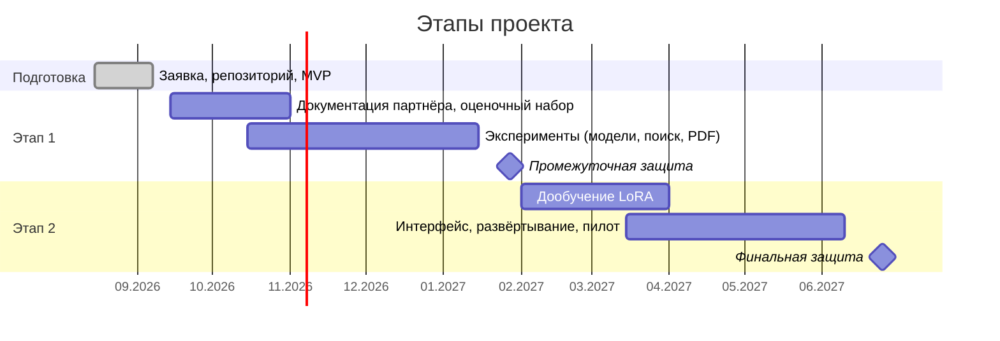

# Дорожная карта. План работ по проекту TechDoc Assistant

**Программа:** «ПроТалант» УрФУ, трек «Цифровое производство: промышленный ИИ, цифровые двойники и робототехника»

**Период:** 05.10.2026 – 30.06.2027

**Промежуточная защита:** 26–29.01.2027

**Финальная защита (этап 2):** 20–30.06.2027

---
План привязан к этапам программы «ПроТалант» УрФУ 2026–2027
([protalant.urfu.ru](https://protalant.urfu.ru/)).

## Этап 0 — заявка и MVP (август – 7 сентября 2026)

- [x] Идея, трек «Цифровое производство: промышленный ИИ, цифровые двойники и робототехника»
- [x] Репозиторий, структура проекта, лицензия, CI
- [x] RAG-пайплайн: загрузка → структурный чанкинг → гибридный поиск → ответ со ссылками
- [x] Система оценки с метриками поиска, ответа, ссылок и галлюцинаций; экстрактивный бейзлайн
- [x] Учебный корпус (3 вымышленных промышленных документа) и 13 оценочных вопросов
- [x] Контур дообучения LoRA (сборка набора, скрипт, dry-run)
- [x] Подача заявки до 7 сентября, результаты отбора — 11 сентября

## Период 1 — исследование (сентябрь 2026 – 25 января 2027)

## Этап 1. Запуск системы на реальной модели и приведение репозитория в порядок

**Статус:** В работе | **Начало:** 05.10.2026 | **Окончание:** 18.10.2026

**Описание:** Первый полный прогон пайплайна (индексация > вопрос > ответ со ссылками > оценка) с настоящей LLM через Ollama вместо офлайн-заглушек. Параллельно — техническая гигиена репозитория: описание и topics на GitHub, унификация целевой модели между README и контуром дообучения, бейджи в README, релиз 1.1.1, проверка quickstart на чистой машине.

**Ожидаемый результат:** работающая end-to-end система с реальными метриками, воспроизводимая одной командой по README.

**Планируемый артефакт:** релиз на [GitHub](https://github.com/Voldemurik/URFU-PROTALANT) + заполненная первая строка таблицы метрик в docs/evaluation.md.

**Шаги:**

| № | Шаг | Сроки | Выполнение |
| --- | --- | --- | --- |
| 1 | Гигиена репозитория: описание и topics на GitHub, бейджи в README, тег и релиз 1.1.1 | 05.10.2026 – 11.10.2026 | Сделано ✅ |
| 2 | Установка Ollama, проверка тегов моделей, первый живой прогон с eval --judge, первая строка реальных метрик в [docs/evaluation.md](https://github.com/Voldemurik/URFU-PROTALANT/blob/main/docs/evaluation.md) | 12.10.2026 – 18.10.2026 | В работе ⏳ |

---

## Этап 2. Сбор реального корпуса документации

**Статус:** Запланировано | **Начало:** 19.10.2026 | **Окончание:** 08.11.2026

**Описание:** Замена учебного корпуса на реальный: запрос документации у партнёра/кафедры, параллельно — публичные руководства производителей, ГОСТы, документация открытых систем ЧПУ. Адаптация загрузчиков под реальные PDF (кодировки, колонтитулы, таблицы). Расширение оценочного набора до 40+ вопросов, включая вопросы-ловушки по новым документам.

**Ожидаемый результат:** корпус из 30–50 реальных документов и оценочный набор 40+ вопросов; метрики системы измерены на реальных данных.

**Планируемый артефакт:** набор данных (корпус) в [репозитории](https://github.com/Voldemurik/URFU-PROTALANT), обновлённый отчёт метрик [docs/evaluation.md](https://github.com/Voldemurik/URFU-PROTALANT/blob/main/docs/evaluation.md).

**Шаги:**

| № | Шаг | Сроки | Выполнение |
| --- | --- | --- | --- |
| 1 | Сбор публичных руководств и ГОСТов (партнёры/ВУЗ) | 19.10.2026 – 25.10.2026 | Запланировано |
| 2 | Правки загрузчиков под реальные PDF (кодировки, колонтитулы, таблицы) | 26.10.2026 – 01.11.2026 | Запланировано |
| 3 | Приём данных корпуса, прогон метрик, сравнение с бейзлайном, расширение eval-набора до 40+ вопросов с ловушками | 02.11.2026 – 08.11.2026 | Запланировано |

---

## Этап 3. Повышение качества поиска и обработки PDF

**Статус:** Запланировано | **Начало:** 09.11.2026 | **Окончание:** 06.12.2026

**Описание:** Четыре измеримых улучшения, каждое с замером «до/после»: морфология для BM25, номера страниц PDF в ссылках на источники, переранжирование кросс-энкодером, подбор параметров разбиения по сетке экспериментов.

**Ожидаемый результат:** рост recall\@k и MRR по сравнению с бейзлайном, ссылки в ответах ведут на конкретную страницу документа.

**Планируемый артефакт:** код улучшений и таблица «до/после» по каждому эксперименту в [docs/evaluation.md](https://github.com/Voldemurik/URFU-PROTALANT/blob/main/docs/evaluation.md).

**Шаги:**

| № | Шаг | Сроки | Выполнение |
| --- | --- | --- | --- |
| 1 | Морфология BM25: интеграция, тесты, замер до/после | 09.11.2026 – 15.11.2026 | Запланировано |
| 2 | Номера страниц PDF в ссылках: правки loaders/chunking, демо «ссылка > страница» | 16.11.2026 – 22.11.2026 | Запланировано |
| 3 | Переранжирование кросс-энкодером: код, конфиг, эксперимент до/после | 23.11.2026 – 29.11.2026 | Запланировано |
| 4 | Сетка экспериментов chunk_size/top_k, выбор оптимума | 30.11.2026 – 06.12.2026 | Запланировано |

---

## Этап 4. Сравнение моделей, антигаллюцинации, открытый бенчмарк

**Статус:** Запланировано | **Начало:** 07.12.2026 | **Окончание:** 10.01.2027

**Описание:** Сравнение генеративных моделей (qwen2.5:7b-instruct, qwen2.5:3b-instruct и другие) и эмбеддингов (bge-m3, qwen3-embedding, GigaEmbeddings — специализированная русская модель) на единой системе оценки. Борьба с галлюцинациями: промпт-инжиниринг и второй проход проверки, цель — рост trap_refusal_rate без роста false_refusal_rate. Оформление оценочного набора как открытого русскоязычного бенчмарка промышленной техдокументации (100+ вопросов, лицензия, протокол).

**Ожидаемый результат:** сводная таблица сравнения моделей, измеримо сниженная доля галлюцинаций, опубликованный бенчмарк 100+ вопросов.

**Планируемый артефакт:** публичный датасет-бенчмарк с README и протоколом оценки, сводная таблица моделей в [репозитории](https://github.com/Voldemurik/URFU-PROTALANT).

**Шаги:**

| № | Шаг | Сроки | Выполнение |
| --- | --- | --- | --- |
| 1 | Прогоны и сводная таблица генеративных моделей | 07.12.2026 – 13.12.2026 | Запланировано |
| 2 | Сравнение эмбеддингов: bge-m3, qwen3-embedding, GigaEmbeddings | 14.12.2026 – 20.12.2026 | Запланировано |
| 3 | Антигаллюцинации: промпт-инжиниринг, второй проход проверки, замер trap/false refusal rates | 21.12.2026 – 27.12.2026 | Запланировано |
| 4 | Доводка бенчмарка до 100+ вопросов, оформление README датасета и протокола | 28.12.2026 – 03.01.2027 | Запланировано |
| 5 | Публикация бенчмарка, финальные контрольные замеры | 04.01.2027 – 10.01.2027 | Запланировано |

---

## Этап 5. Демо и подготовка к промежуточной защите

**Статус:** Запланировано | **Начало:** 11.01.2027 | **Окончание:** 25.01.2027

**Описание:** Прототип мультимодальности: чтение сканов чертежей и табличек внутри PDF при индексации. Запись демо-видео: ответ со ссылками > отказ на вопросе-ловушке > работа с чертежом. Финальный отчёт к промежуточной защите: метрики до/после, архитектура, сценарии развёртывания (сервер контура, одиночный ПК), репетиция. Промежуточная защита этапа 1 — 26–29.01.2027.

**Ожидаемый результат:** готовый к показу продукт с демонстрацией ключевых фич и полный комплект материалов к защите 26–29 января.

**Планируемый артефакт:** PDF-отчёт, демо-видео/GIF в README [репозитория](https://github.com/Voldemurik/URFU-PROTALANT).

**Шаги:**

| № | Шаг | Сроки | Выполнение |
| --- | --- | --- | --- |
| 1 | Прототип чтения сканов/чертежей при индексации (vision-модель) | 11.01.2027 – 17.01.2027 | Запланировано |
| 2 | Запись демо (ответ со ссылками, отказ на ловушке, чертёж), GIF в README, черновик отчёта к защите | 18.01.2027 – 24.01.2027 | Запланировано |
| 3 | Финализация отчёта, репетиция, чистка репозитория | 24.01.2027 – 25.01.2027 | Запланировано |

---
## Этап 2 — продукт (1 февраля – 20 июня 2027)

## Идеи на потом

- Многошаговый поиск (переформулировка вопроса моделью, «уточняющие» запросы).
- Работа с чертежами и схемами через мультимодальные модели (qwen3.5 и gemma4 умеют читать изображения).
- Интеграция с системами предприятия (Confluence/СЭД) для автоматической переиндексации.
- Режим «объясни как новичку» для обучения новых сотрудников.

## Риски и что с ними делать

| Риск | Действие |
|---|---|
| Не удастся получить реальную документацию | Публичные ГОСТы, руководства с сайтов производителей, документация открытых проектов (например, открытой системы ЧПУ LinuxCNC) |
| Слабое железо для 9B-моделей | Модели 4B, квантование, CPU-режим; облачные GPU только для обучения адаптера, без данных партнёра |
| LLM-судья ненадёжен | Опора на «жёсткие» метрики (ловушки, обязательные факты, ссылки), ручная проверка выборки |
| Дообучение ухудшит модель | Сравнение на отложенной выборке, откат к базовой модели, адаптер как опция |
