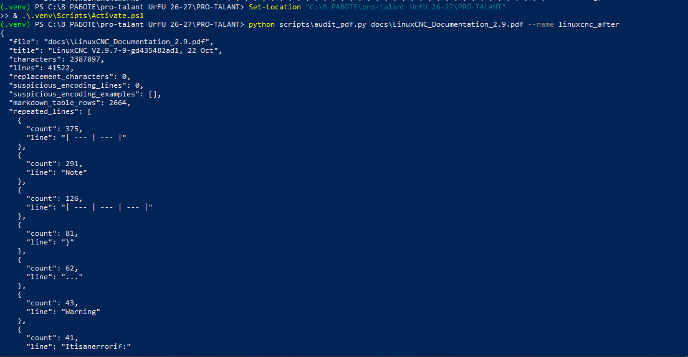
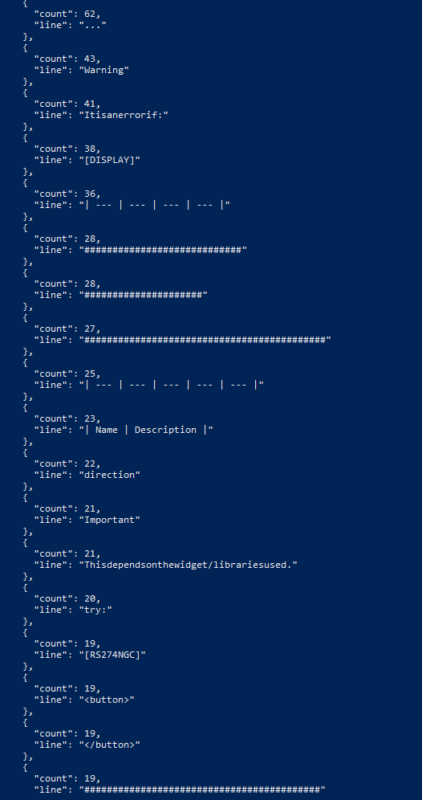
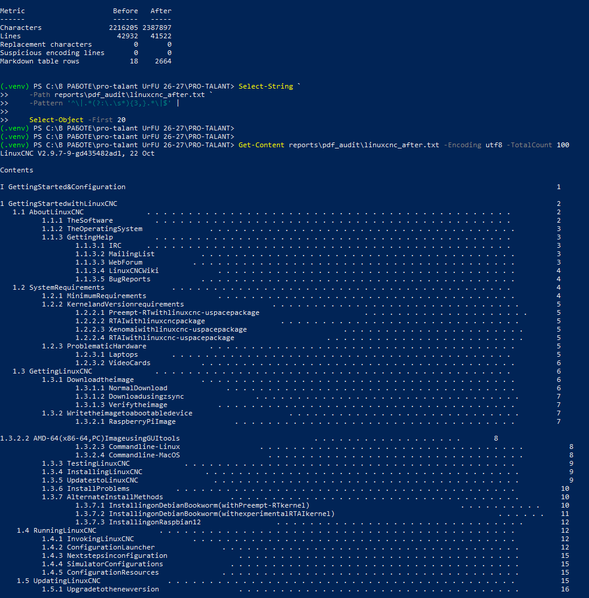
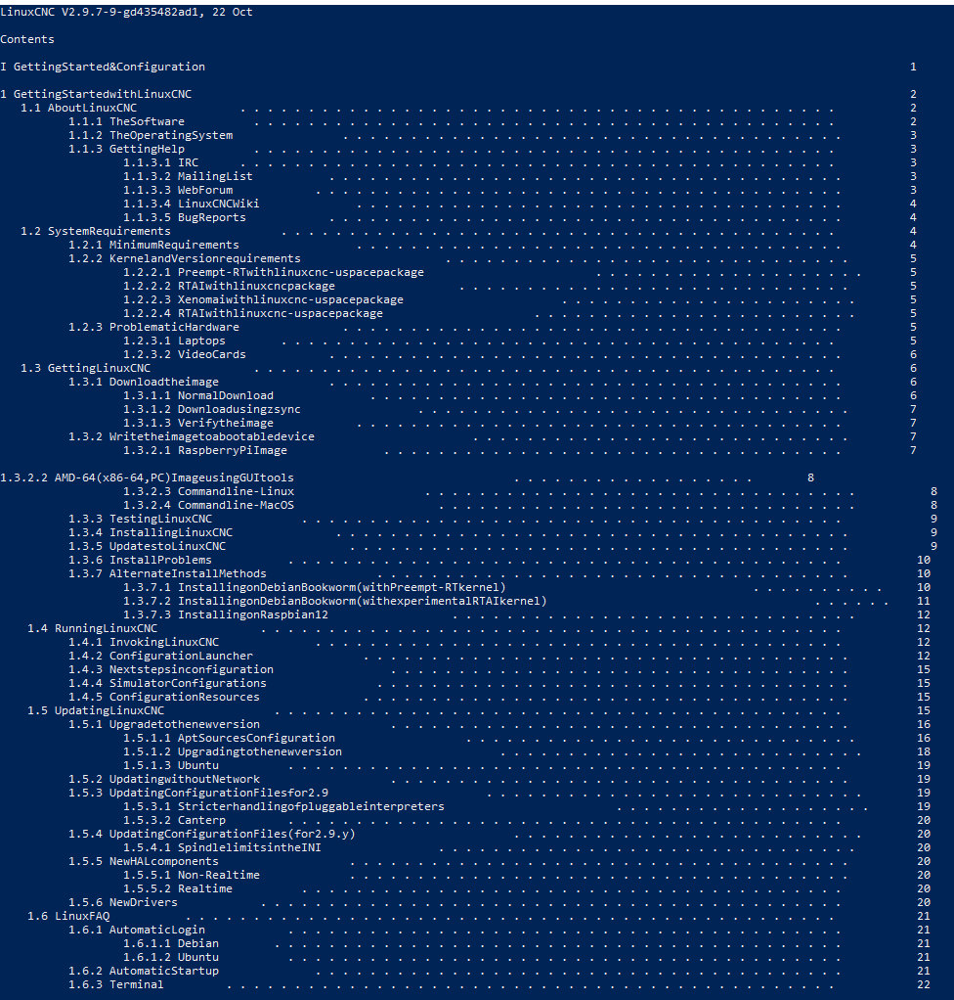
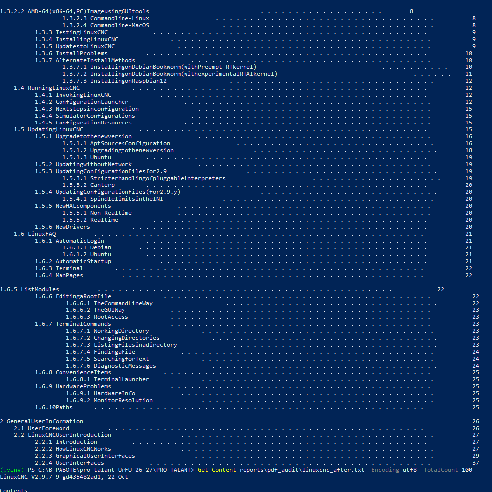
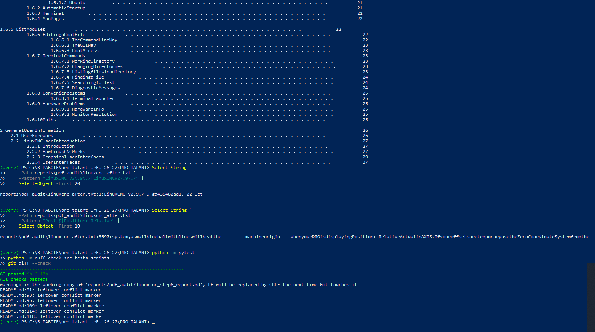

# Итоговый отчёт по пункту 6: проверка очистки LinuxCNC PDF

- **Дата фиксации:** 29.10.2026.
- **Документ:** [LinuxCNC_Documentation_2.9.pdf](../../docs/LinuxCNC_Documentation_2.9.pdf).
- **Базовый аудит:** [linuxcnc_before.json](linuxcnc_before.json).
- **Итоговый аудит:** [linuxcnc_after.json](linuxcnc_after.json).
- **Статус PDF-проверки:** **автоматические проверки пройдены; ложные таблицы в содержании устранены**.
- **Остающиеся действия:** ручная выборочная проверка страниц и разрешение конфликтных маркеров в [README.md](../../README.md).

Отчёт обновлён по семи скриншотам повторной проверки после исправления табличной эвристики. Строки содержания с точками-заполнителями (`...` и `. . .`) теперь исключаются из преобразования в Markdown-таблицы.

## 1. Итоговый аудит

Выполненная команда:

```powershell
python scripts\audit_pdf.py docs\LinuxCNC_Documentation_2.9.pdf --name linuxcnc_after
```

Сформированы файлы:

- [linuxcnc_after.json](linuxcnc_after.json);
- [linuxcnc_after.txt](linuxcnc_after.txt).

Характеристики итогового текста:

| Показатель | Результат |
| --- | ---: |
| Символы | 2 387 897 |
| Строки | 41 522 |
| Символы замены `�` | 0 |
| Строки с подозрением на повреждение кодировки | 0 |
| Строки Markdown-таблиц | 2 664 |

В итоговом JSON сохраняются реальные табличные конструкции, включая 375 разделителей `| --- | --- |`, 126 разделителей `| --- | --- | --- |` и 23 строки `| Name | Description |`.





## 2. Сравнение с базовым аудитом

| Показатель | До | После | Изменение |
| --- | ---: | ---: | ---: |
| Символы | 2 216 205 | 2 387 897 | +171 692 |
| Строки | 42 932 | 41 522 | −1 410 |
| Символы замены `�` | 0 | 0 | 0 |
| Строки с подозрением на повреждение кодировки | 0 | 0 | 0 |
| Строки Markdown-таблиц | 18 | 2 664 | +2 646 |

По сравнению с промежуточным результатом до исправления содержания число Markdown-строк уменьшилось с 4 417 до 2 664, то есть на 1 753. Это согласуется с удалением ложных табличных преобразований.

Рост общего количества символов относительно базового аудита не является ошибкой сам по себе: layout-режим и Markdown-разметка добавляют пробелы и служебные символы. Ошибки кодировки не появились.



## 3. Проверка ложных таблиц в содержании

Выполненная команда:

```powershell
Select-String `
    -Path reports\pdf_audit\linuxcnc_after.txt `
    -Pattern '^\|.*(?:\.\s*){3,}.*\|$' |
    Select-Object -First 20
```

Команда не вернула совпадений.

Просмотр первых 100 строк подтверждает, что содержание сохранено как обычные строки с точками-заполнителями и номерами страниц. Добавленные ранее `|` и Markdown-разделители в показанном содержании отсутствуют.

**Результат:** ложное преобразование содержания в таблицы устранено.





## 4. Проверка повторяющихся колонтитулов

Выполненная команда проверяет оба варианта написания — с пробелами и без них:

```powershell
Select-String `
    -Path reports\pdf_audit\linuxcnc_after.txt `
    -Pattern "LinuxCNC V2\.9\.7|LinuxCNCV2\.9\.7" |
    Select-Object -First 20
```

Найдено одно совпадение:

```text
reports\pdf_audit\linuxcnc_after.txt:1:LinuxCNC V2.9.7-9-gd435482ad1, 22 Oct
```

Это название документа в первой строке. Повторяющихся колонтитулов `LinuxCNCV2.9.7...` в итоговом TXT по данным этой команды не обнаружено.

**Результат:** проверка колонтитулов пройдена.

## 5. Проверка переносов слов

Выполненная команда:

```powershell
Select-String `
    -Path reports\pdf_audit\linuxcnc_after.txt `
    -Pattern "Posi-$|Position: Relative" |
    Select-Object -First 10
```

Найдена строка 3690, содержащая контрольный фрагмент:

```text
Position: Relative
```

Отдельного совпадения с разрывом `Posi-` в конце строки не показано.

**Результат:** контрольный пример переноса успешно устранён. Это не исключает другие особенности извлечения: вокруг фрагмента остаются склеенные слова, характерные для layout-представления исходного PDF.

## 6. Автоматические тесты и проверка репозитория

Выполненные команды:

```powershell
python -m pytest
python -m ruff check src tests scripts
git diff --check
```

Результаты:

| Проверка | Результат |
| --- | --- |
| Pytest | `69 passed in 6.17s` |
| Ruff | `All checks passed!` |
| `git diff --check` | Обнаружены конфликтные маркеры в [README.md](../../README.md) |

`git diff --check` показывает `leftover conflict marker` в строках 91, 93, 95, 109, 114 и 118 файла [README.md](../../README.md). Это отдельная проблема состояния репозитория, а не ошибка PDF-загрузчика. Предупреждение о будущей замене LF на CRLF в отчёте носит информационный характер.



## 7. Итоговая оценка

| Критерий | Результат |
| --- | --- |
| Повторный аудит выполнен | Пройдено |
| JSON и TXT после изменений созданы | Пройдено |
| Обработка изменила извлечённый текст | Подтверждено |
| Новые ошибки кодировки отсутствуют | Пройдено |
| Повторяющиеся колонтитулы удалены | Пройдено по результатам поиска обоих вариантов |
| Контрольный перенос слова устранён | Пройдено для `Position` |
| Ложные таблицы в содержании устранены | Пройдено |
| Полный набор автоматических тестов | `69 passed` |
| Ruff | Пройдено |
| `git diff --check` | Не пройдено из-за конфликтных маркеров в [README.md](../../README.md) |
| Ручная проверка выборки страниц | На представленных скриншотах не зафиксирована |

**Общий вывод:** исправление табличной эвристики успешно проверено. Содержание больше не превращается в Markdown-таблицы, колонтитулы удалены, контрольный перенос устранён, все 69 тестов и Ruff проходят. Автоматическую часть пункта 6 можно считать выполненной.

Перед полным закрытием пункта 6 необходимо задокументировать ручную проверку выборки обычных страниц, таблиц, кода и рисунков, а также разрешить конфликтные маркеры в [README.md](../../README.md) и повторить `git diff --check`.
