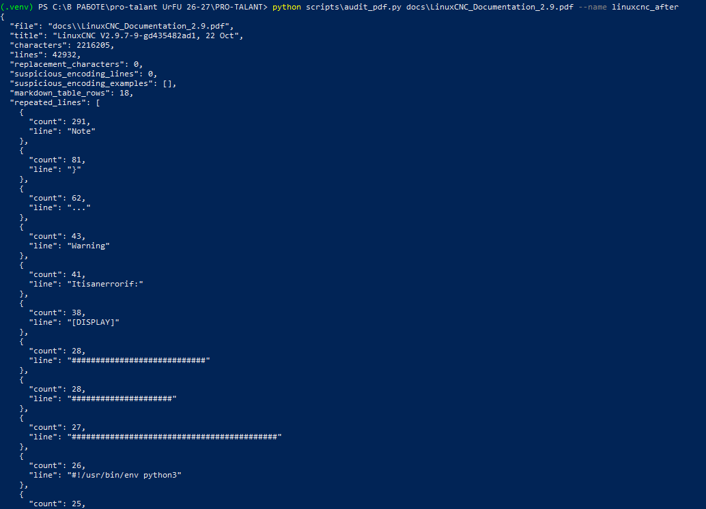
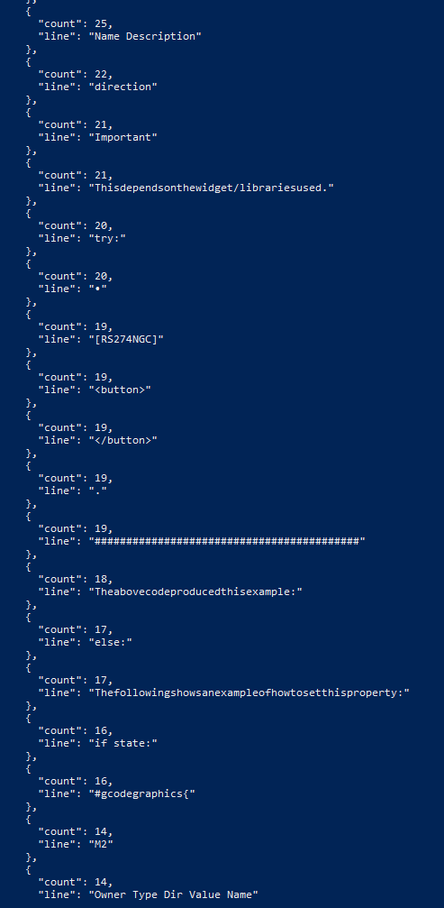
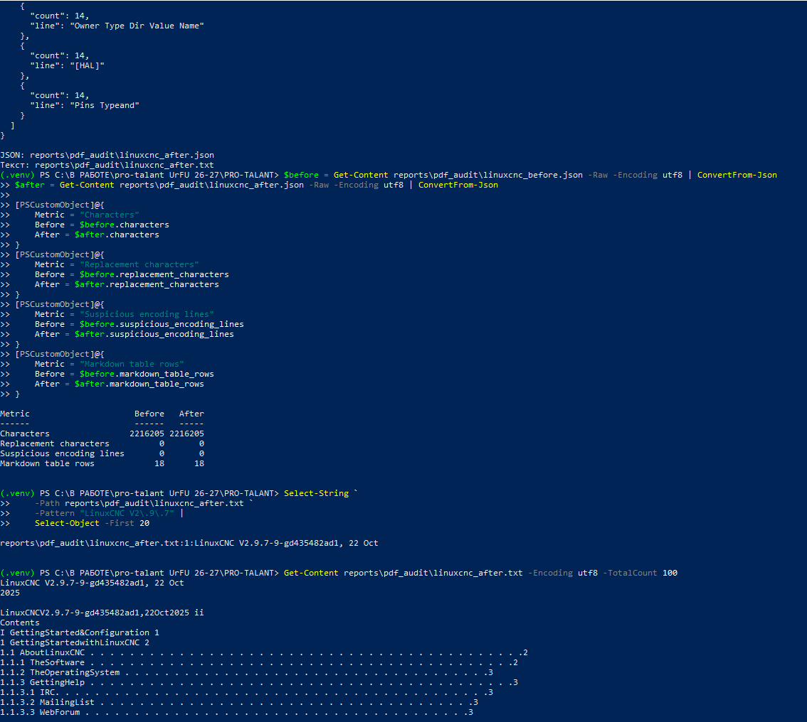
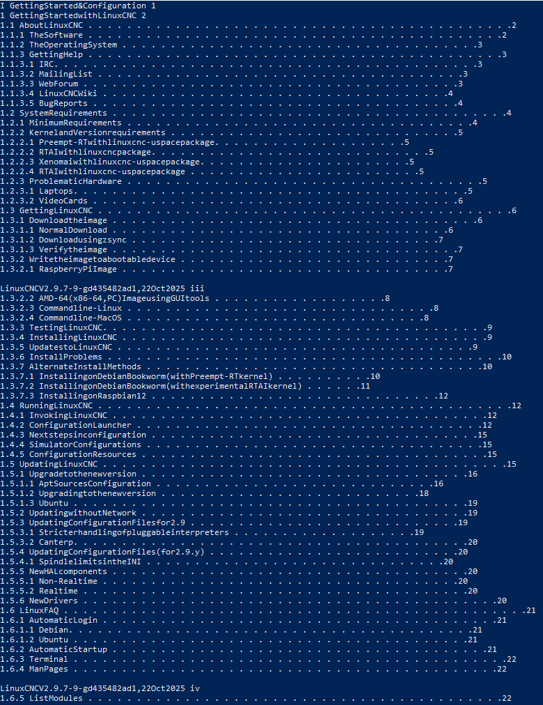
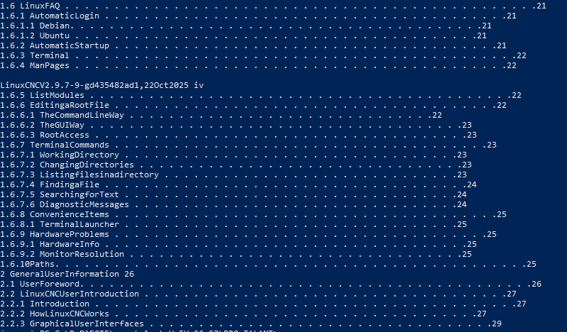

# Отчёт по пункту 6: проверка очистки LinuxCNC PDF

- **Дата фиксации:** 29.10.2026.
- **Документ:** `docs/LinuxCNC_Documentation_2.9.pdf`.
- **Базовый аудит:** `reports/pdf_audit/linuxcnc_before.json`.
- **Аудит после изменений:** `reports/pdf_audit/linuxcnc_after.json`.
- **Статус проверки:** **требуется доработка; эффект очистки не подтверждён**.

Отчёт подготовлен по пяти предоставленным скриншотам выполнения команд пункта 6.

## 1. Повторный аудит после изменений

Выполненная команда:

```powershell
python scripts\audit_pdf.py docs\LinuxCNC_Documentation_2.9.pdf --name linuxcnc_after
```

Команда завершилась формированием файлов:

- `reports/pdf_audit/linuxcnc_after.json`;
- `reports/pdf_audit/linuxcnc_after.txt`.

Зафиксированные характеристики извлечённого текста:

| Показатель | После изменений |
| --- | ---: |
| Символы | 2 216 205 |
| Строки | 42 932 |
| Символы замены `�` | 0 |
| Строки с подозрением на повреждение кодировки | 0 |
| Строки Markdown-таблиц | 18 |

В списке повторяющихся строк остаются, среди прочих, `Note` — 291 вхождение, `Warning` — 43, `...` — 62. Эти строки сами по себе не являются ошибкой: часть из них относится к содержательному тексту документации.





## 2. Сравнение показателей до и после

В PowerShell загружены оба JSON-отчёта и сравнены основные показатели.

| Показатель | До | После | Изменение |
| --- | ---: | ---: | ---: |
| Символы | 2 216 205 | 2 216 205 | 0 |
| Символы замены `�` | 0 | 0 | 0 |
| Строки с подозрением на повреждение кодировки | 0 | 0 | 0 |
| Строки Markdown-таблиц | 18 | 18 | 0 |

**Результат:** измеримых различий между базовым и итоговым аудитом не обнаружено. Количество извлечённых символов не уменьшилось, поэтому удаление повторяющихся колонтитулов этим сравнением не подтверждается. Число Markdown-строк таблиц также не изменилось.



## 3. Проверка повторяющегося колонтитула

Выполненная команда:

```powershell
Select-String `
    -Path reports\pdf_audit\linuxcnc_after.txt `
    -Pattern "LinuxCNC V2\.9\.7" |
    Select-Object -First 20
```

Найдено одно совпадение:

```text
reports\pdf_audit\linuxcnc_after.txt:1:LinuxCNC V2.9.7-9-gd435482ad1, 22 Oct
```

Это совпадение находится в первой строке и соответствует названию документа. Однако предварительный просмотр текста показывает, что в содержании остаются компактные варианты колонтитула без пробелов, например:

```text
LinuxCNCV2.9.7-9-gd435482ad1,22Oct2025 ii
LinuxCNCV2.9.7-9-gd435482ad1,22Oct2025 iv
```

Следовательно, проверка только шаблона с пробелами не подтверждает удаление всех вариантов колонтитула.

## 4. Предварительный просмотр извлечённого текста

Выполненная команда:

```powershell
Get-Content reports\pdf_audit\linuxcnc_after.txt -Encoding utf8 -TotalCount 100
```

Текст успешно читается, содержание документа извлечено. При этом в первых 100 строках видны:

- компактные колонтитулы `LinuxCNCV2.9.7...`;
- склеенные названия разделов, например `GettingStartedWithLinuxCNC`;
- строки содержания с точками-заполнителями и номерами страниц.

Эти особенности исходной вёрстки после обработки сохранились.





## 5. Проверка переносов слов

В инструкции пункта 6 предусмотрена команда:

```powershell
Select-String `
    -Path reports\pdf_audit\linuxcnc_after.txt `
    -Pattern "Posi-$|Position: Relative" |
    Select-Object -First 10
```

Её отдельный результат на предоставленных скриншотах не зафиксирован. Поэтому вывод об устранении переносов слов в рамках данного отчёта не делается.

## 6. Итог

| Критерий | Результат |
| --- | --- |
| Повторный аудит выполнен | Подтверждено |
| JSON и TXT после изменений созданы | Подтверждено |
| Новые ошибки кодировки отсутствуют | Подтверждено: их также не было до изменений |
| Уменьшение объёма за счёт очистки | Не подтверждено |
| Удаление повторяющихся колонтитулов | Не подтверждено; компактные варианты остались |
| Изменение представления таблиц | Не зафиксировано |
| Устранение переносов слов | Не проверено на представленных скриншотах |

**Общий вывод:** контрольная проверка выявила отсутствие измеримого эффекта обработки. По скриншотам нельзя установить причину: правки могли не попасть в используемый загрузчик либо алгоритм очистки мог не сработать на данном PDF. Пункт 6 нельзя считать успешно завершённым.

Для повторной проверки необходимо убедиться, что аудит использует изменённый `src/techdoc_assistant/loaders.py`, повторно сформировать `linuxcnc_after`, проверить оба варианта колонтитула и отдельно зафиксировать результат проверки переносов слов и выборки таблиц.
