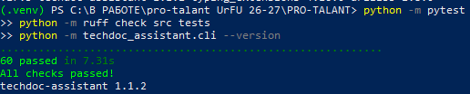

# Исходный результат проверок перед шагом 2 этапа 2

- **Дата фиксации:** 27.10.2026.
- **Состояние проекта:** до изменений PDF-загрузчика.
- **Версия:** `techdoc-assistant 1.1.2`.
- **Окружение:** виртуальное окружение `.venv`, Windows, PowerShell.

## Выполненные команды и результаты

| Команда | Результат |
| --- | --- |
| `python -m pytest` | `60 passed in 7.31s` |
| `python -m ruff check src tests` | `All checks passed!` |
| `python -m techdoc_assistant.cli --version` | `techdoc-assistant 1.1.2` |

**Итог:** исходное состояние успешно проходит все 60 автоматических тестов и проверку Ruff. Этот результат используется как базовая точка для сравнения после доработки загрузки PDF.

## Исходный скриншот

